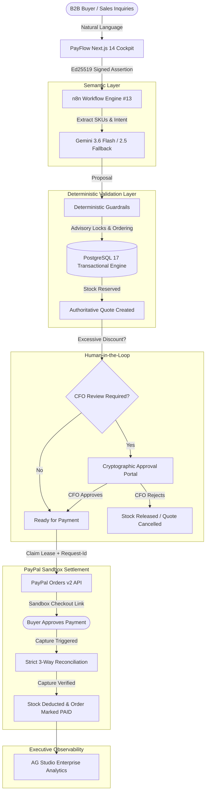

# PayFlow AI

**Autonomous Enterprise Quote-to-Cash Agent with Deterministic Guardrails & PayPal Settlement**

*Built for the PayPal AI Hackathon 2026 on Devpost.*

[](https://opensource.org/licenses/MIT)
[](tests/)
[](frontend-payflow/tests/)
[](https://developer.paypal.com/)
[](https://deepmind.google/technologies/gemini/)

---

## Executive Overview

90% of AI commerce applications are vulnerable to **prompt injection, price hallucinations, and unauthorized discount smuggling**. If a generative model is allowed to calculate prices or directly issue payment links, merchants risk catastrophic margin erosion and inventory corruption.

**PayFlow AI solves this by introducing the "AI Proposes, Determinism Disposes" paradigm:**
1. **AI Copilot (Google Gemini 3.6 & 2.5 Flash)** understands complex buyer requests in French or English and extracts catalog items and business intent.
2. **Deterministic Engine (PostgreSQL 17 & n8n)** calculates mathematical prices, checks available stock, enforces hard margin floors, and serializes inventory reservations with transactional advisory locks.
3. **Human-in-the-Loop (HITL) Governance** intercepts quotes that exceed commercial discount thresholds or breach margin limits, requiring CFO approval via one-time cryptographic tokens.
4. **PayPal Orders v2 Sandbox** issues immutable checkout sessions generated strictly from verified database records—completely ignoring client-side parameters.
5. **3-Way Reconciliation** verifies merchant ID, currency, and exact amount before and after capture, updating physical stock only upon cryptographically proven settlement.
6. **AG Studio Analytics** provides real-time executive visibility over pipeline conversion, payment health, and anomaly telemetry.

---

## Architecture



---

## Key Differentiators

| Feature | Typical Hackathon Wrapper | PayFlow AI Architecture |
| :--- | :--- | :--- |
| **Pricing Calculation** | Delegated to LLM (vulnerable to prompt injection) | **Strictly deterministic** from PostgreSQL product snapshots |
| **Discount Enforcement** | Prompt instruction ("Please don't give > 10%") | **Regex prompt re-scan + hard database margin floors** |
| **Concurrency / Stock** | Optimistic / uncoordinated API calls | **`ORDER BY id FOR UPDATE` + PostgreSQL advisory locks** |
| **PayPal Payload** | Uses client-supplied JSON parameters | **Constructed exclusively from frozen database items** |
| **Payment Idempotence** | Basic client-side debounce | **120s advisory lease + deterministic `PayPal-Request-Id`** |
| **Model Resilience** | Single endpoint (fails on 429/503 quota errors) | **Automatic fallback from Gemini 3.6 to Gemini 2.5 Flash** |
| **Security Assertions** | Shared API key or unauthenticated webhooks | **Ed25519-signed operator assertions with 90s replay window** |

---

## Project Structure

```
deliverables/payflow-ai/
├── README.md                      # Executive documentation & quickstart
├── LICENSE                        # Official MIT open-source license
├── compose.yaml                   # Production-grade PostgreSQL & n8n stack
├── docs/
│   ├── ARCHITECTURE.md            # Deep-dive architecture & threat model
│   ├── JUDGE_ACCESS.md            # Evaluator instructions & test scenarios
│   └── DEMO.md                    # Interactive demo script and scenarios
├── frontend-payflow/              # Next.js 14 / React 18 / Tailwind Cockpit
│   ├── src/app/                   # App Router pages and API gateway
│   ├── src/components/            # AG Studio dashboard and HITL controls
│   ├── src/lib/                   # Ed25519 operator authentication & sessions
│   └── tests/                     # 18/18 security and gateway unit tests
├── sql/
│   ├── 10_payflow_init.sql        # Core tables, catalogue, and constraints
│   ├── 11_payflow_stabilization.sql # Concurrency, claim leases, and advisory locks
│   └── 12_payflow_quote_lifecycle.sql # Quote expiry and cancellation lifecycles
├── workflows/
│   └── 10_payflow_hackathon/      # Engine #13 n8n JSON workflow definition
└── tests/
    └── test_scripts/              # 44/44 backend & deterministic unit tests
```

---

## Quickstart

### Prerequisites
* Node.js 20+, npm, and Docker with Compose v2.
* Local ports `3005` (Cockpit) and `5679` (n8n) available.

### Installation

1. **Install dependencies**:
   ```bash
   npm ci --prefix frontend-payflow
   ```

2. **Initialize Database & Credentials**:
   ```bash
   npm run setup
   ```
   *Starts isolated PostgreSQL container, runs atomic SQL migrations, seeds the 5-product catalog, and generates local operator login credentials.*

3. **Run Test Suites**:
   ```bash
   # Run the 44 deterministic engine unit tests
   node tests/test_scripts/test_payflow_stabilized_logic.cjs

   # Run the 18 frontend security & authentication tests
   npm test --prefix frontend-payflow
   ```

4. **Launch Cockpit**:
   ```bash
   npm run frontend
   ```
   Open `http://127.0.0.1:3005` in your browser and log in with your generated operator credentials.

For complete judge instructions, scenario walkthroughs, and PayPal Sandbox setup, please see [docs/JUDGE_ACCESS.md](docs/JUDGE_ACCESS.md).

---

## License

This project is licensed under the [MIT License](LICENSE).
